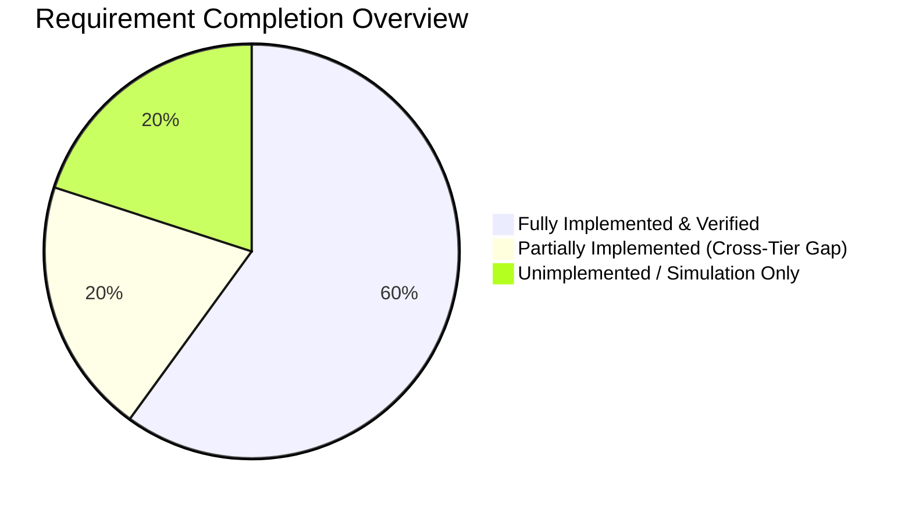
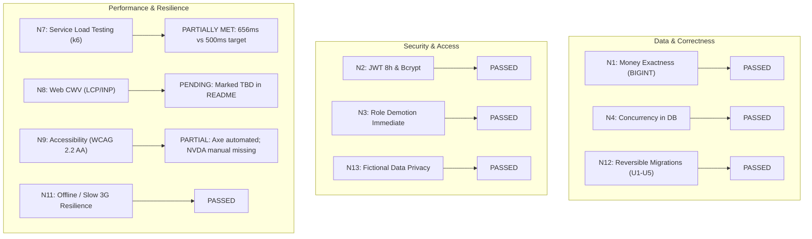
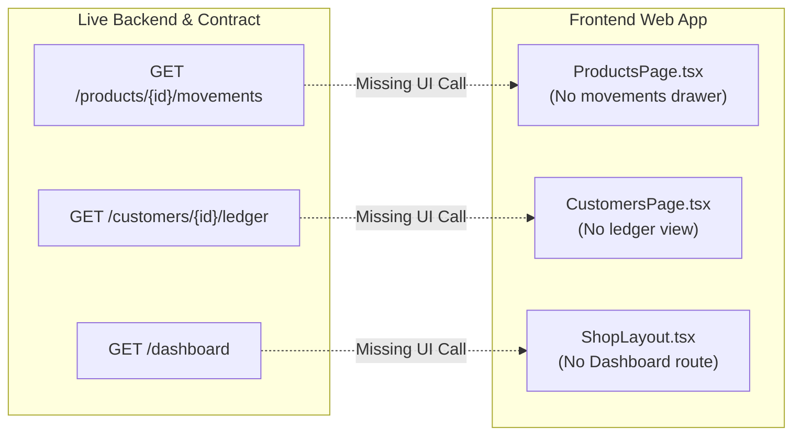
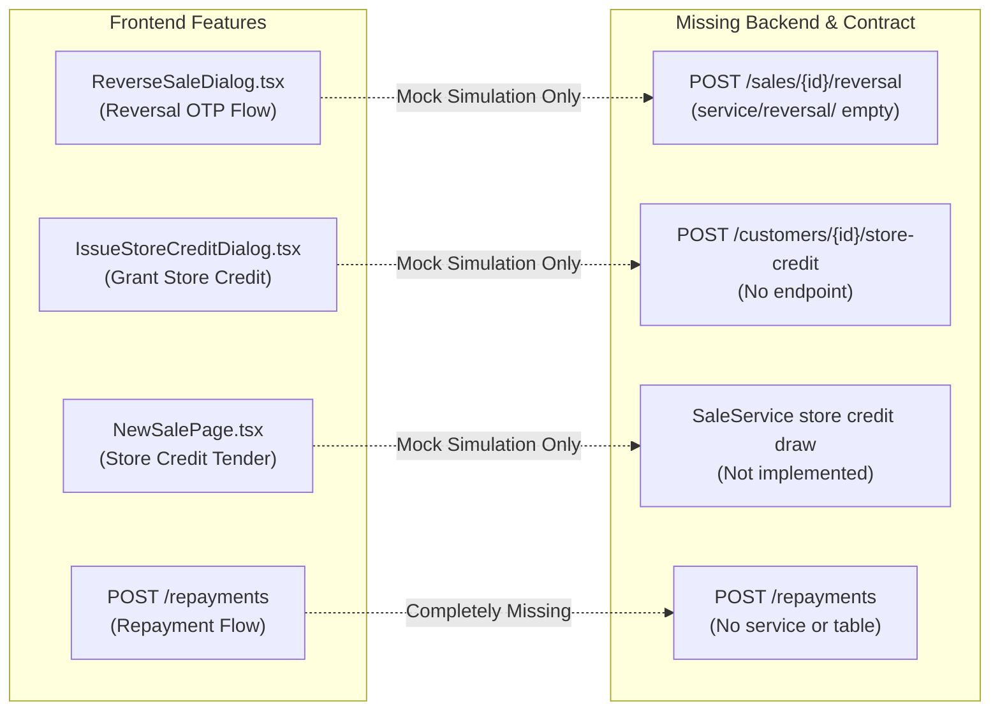

# Stockwise: End-to-End Scope Coverage & Requirements Audit

**Product:** Stockwise (Team 3 Main Product, TeSA Cohort 6 Capstone)  
**Date of Audit:** 2026-10-30  
**Source Baseline:** `sdlc/intent.md`, `sdlc/spec.md`, `sdlc/plan.md`, `sdlc/test-plan.md`, `sdlc/WORKLOG.md`, `decisions.md`, `contract/openapi.yaml`, and git branch `origin/main` (commit `da60dfcf`)

---

## 1. Executive Summary & Status Scorecard

This document provides a comprehensive audit of the Stockwise codebase against all functional requirements (R1–R20), non-functional requirements (N1–N15), success criteria (S1–S8), and capstone assessment rubric deliverables.

### High-Level Summary Table

| Category | Total | Fully Met | Partial / Tier Gap | Missing / Simulation Only |
|---|:---:|:---:|:---:|:---:|
| **Functional Requirements (R1–R20)** | 20 | 12 | 4 | 4 |
| **Non-Functional Requirements (N1–N15)** | 15 | 11 | 3 | 1 |
| **Success Criteria (S1–S8)** | 8 | 5 | 2 | 1 |
| **Capstone Rubric Artifacts** | 5 | 1 | 0 | 4 |

---

## 2. Functional Requirements Traceability Matrix (R1 – R20)

| ID | Requirement | Contract (`openapi.yaml`) | Backend Service (`service/`) | Database & Migrations | Web Interface (`web/`) | Automated Verification | Status |
|:---:|---|:---:|:---:|:---:|:---:|:---:|:---:|
| **R1** | **Product Catalogue:** Create, edit, archive, unique reference | `GET/POST /products` present; `PATCH /products/{id}` **Missing** | `ProductController.java`, `ProductRepository.java` (Create, list, find). Edit/archive **Missing** | `V2__products.sql` (`product_reference_uq`, `CHECK (quantity >= 0)`) | `AddProductForm.tsx`, `ProductsPage.tsx`. Edit & archive UI **Missing** | `ProductValidationTest.java`, `ProductRepositoryIT.java`, Playwright `products.spec.ts` | **Partial** (Creation/view done; edit/archive missing) |
| **R2** | **Product Search & Filter:** Keyword, category, stock state, active | `GET /products`, `GET /product-categories` (Proposal D) | Filter queries in `ProductRepository.java`, `ProductCategoryController.java` | Indexes on `(active, category)`, partial index on low stock | `ProductsPage.tsx` search input, category combobox, stock status tabs | `ProductFilterTest.java`, `ProductRepositoryIT.java` | **Covered** |
| **R3** | **Record a Sale:** Paid or credit, stock reduction, price copying | `POST /sales` (201, 400, 409) | `SaleService.java`, `SaleController.java`, `SaleRepository.java` | `V3__customers_sales_ledger.sql` (`sale`, `sale_line`, `stock_movement`) | `NewSalePage.tsx`, catalogue steppers, customer selector | `SaleIT.java`, `SaleConcurrencyIT.java`, Playwright `sales.spec.ts` | **Covered** |
| **R4** | **Stock Never Falls Below Zero:** Concurrency protection | Documented 409 `INSUFFICIENT_STOCK` | Conditional SQL `UPDATE ... WHERE active AND quantity >= :q RETURNING price_kobo` | `CHECK (quantity >= 0)` constraint backstop | UI displays stock limits and handles 409 conflict | `SaleConcurrencyIT.java`, `evidence/no-stock-guard`, `last-unit.mjs` (9/9 pass) | **Covered** |
| **R5** | **Repeat Submissions are Safe:** Idempotency-Key | Required on `POST /sales`, `POST /restocks`; optional on `POST /customers` | Hashing & replay validation in `SaleService`, `RestockService`, `CustomerController` | Unique constraints on `idempotency_key` | Persistent submission keys in tab storage, safe network retries | `IdempotencyIT.java`, `CustomerIdempotencyIT.java`, `SaleRequestHashTest.java` | **Covered** |
| **R6** | **Restocks:** Record stock replenishment | `POST /restocks`, `GET /restocks`, `GET /restocks/{id}` | `RestockController.java`, `RestockService.java`, `RestockRepository.java` | `V5__restocks.sql`, `U5__restocks.sql` | `RestockProductPage.tsx`, `restocks.api.ts` | `RestockIT.java`, `RestockApiIT.java`, `restocks.spec.ts` | **Covered** |
| **R7** | **Customers:** Create and list customers | `GET /customers`, `POST /customers` | `CustomerController.java`, `CustomerRepository.java` | `customer` table in `V3`, `V4` | `CustomersPage.tsx`, desktop right drawer / mobile modal `CustomerPicker.tsx` | `CustomerPageTest.java`, Playwright `customers.spec.ts` | **Covered** |
| **R8** | **Credit Sale:** Requires customer, due date, updates balance | Documented `dueDate` and `customerId` | `SaleService.record` updates balance and appends `ledger_entry` | DB constraint `CHECK (payment_type = 'PAID' OR customer_id IS NOT NULL)` | New Sale credit toggle, customer picker, due date picker | `SaleIT.java` (credit cases), `SchemaRulesIT.java` | **Covered** |
| **R9** | **Repayments:** Atomic full/partial repayment | **Missing** (`POST /repayments` not in contract) | **Missing** (`RepaymentService`, `RepaymentController` not implemented) | DB support present in `V3` (`ledger_entry`), but no repayment table/service | **Missing** (No "Record Repayment" modal in web UI) | None (Only seeded ledger entries exist) | **Unimplemented** |
| **R10** | **Customer Ledger:** Running balances, reconciliation | `GET /customers/{customerId}/ledger` present | `LedgerController.java`, `LedgerQueries.java` implemented | `ledger_entry` with `balance_after_kobo` | **Missing in shop UI**; only customer portal (`/c/:token`) has balance summary | `LedgerIT.java` | **Partial** (Backend complete; Shop UI missing) |
| **R11** | **Reversing Entries:** Reversal with reason, once-only | **Missing** (Only draft proposal in decisions §3) | **Missing** (`reversal` package contains only `package-info.java`) | Reversal table not migrated | `ReverseSaleDialog.tsx`, `GenerateReversalCodeDialog.tsx` (**Simulation Only**) | `reversals.test.ts` (mock), `check-reversal-simulation.mjs` | **Unimplemented** (Frontend is simulation only) |
| **R12** | **Design Problem:** Reversal of partly repaid credit sale $\to$ store credit | **Missing** in authoritative contract | **Missing** in `SaleService` (no store credit drawdown logic) | Schema has `store_credit_kobo` column | Store credit tender UI and issuing dialog wired to mock simulation | Seed verification only | **Unimplemented** (Frontend is simulation only) |
| **R13** | **Movement History:** Product sales, restocks, reversals | `GET /products/{productId}/movements` present | `MovementController.java`, `MovementQueries.java` implemented | `stock_movement` table with `quantity_after` | **Missing** (No movement history screen or drawer in `web/`) | `MovementHistoryIT.java` | **Partial** (Backend complete; Shop UI missing) |
| **R14** | **Dashboard:** Computed totals, Lagos time, demo badge | `GET /dashboard` present | `DashboardController.java`, `DashboardQueries.java` implemented | Computed on-the-fly from sales and products | **Missing** (No dashboard screen in `web/`; DM60 routed logins directly to feature pages) | `DashboardIT.java` | **Partial** (Backend complete; Shop UI missing) |
| **R15** | **Authentication & Roles:** OWNER, ASSISTANT, ADMIN | `POST /auth/sessions`, `GET /me` | `SecurityConfig.java`, `TokenService.java`, method-level RBAC | `app_user` table in `V1__users.sql` | `AuthOverlay.tsx`, demo autofill, role-filtered navigation | `AuthorizationIT.java`, Playwright `auth.spec.ts` | **Covered** |
| **R16** | **Naira on Screen, Kobo Everywhere Else:** Integer kobo | OpenAPI lint rule `money-is-integer-kobo` | `BIGINT` in DB, `long` in Java, JSON integers | `SchemaRulesIT` proves 0 float/numeric columns | Formatted exclusively in `web/src/lib/money.ts` | `MoneyJsonIT.java`, `SchemaRulesIT.java`, `money.test.ts` | **Covered** |
| **R17** | **Five Screen States:** Loading, empty, error, success, confirm | Documented problem+json error shapes | Global `ProblemHandler.java` RFC 9457 errors | N/A | Skeletons, empty views, error banners, toasts, confirmation dialogs | Component unit tests and Playwright assertions | **Covered** |
| **R18** | **Optimistic Archive with Rollback:** Product archive/unarchive | **Missing** (`PATCH /products/{id}` not in contract) | **Missing** (No `If-Match` version conflict logic implemented) | Version column exists in `product` | **Missing** | None | **Unimplemented** |
| **R19** | **Seed Data with Awkward Cases:** Full volume | Monday seed verified (20 products, 5 customers, 33 sales) | `R__seed_demo.sql` runs in `demo` profile | Seed includes zero-stock, at-threshold, archived, and long names | UI renders seeded cases | `SeedVerificationIT.java` | **Partial** (Monday subset done; 120 products pending) |
| **R20** | **Demo Credentials & Labelling:** README accounts | Documented in contract info | Seeds fixed demo users (`Stockwise-Demo-2026`) | Fictional test accounts seeded | README lists all roles; mock features labelled "Simulation" | Clean-browser smoke run (`scripts/smoke.sh`) | **Covered** |

---

## 3. Non-Functional Requirements Audit (N1 – N15)

| ID | Category | Requirement Summary | Verification Result | Status |
|:---:|---|---|---|:---:|
| **N1** | Correctness | Integer kobo stored as `BIGINT`, Java `long`, JSON integers. No floats. | Verified by `SchemaRulesIT` and `MoneyJsonIT`. Jackson rejects floats. | **Met** |
| **N2** | Security | Endpoints require JWT bearer; HS256 secret; 8-hour expiry; bcrypt cost 10; Gitleaks scan. | Verified in `SecurityConfig`, `TokenService`, and CI Gitleaks action. | **Met** |
| **N3** | Authorisation | Role enforcement at method level; roles re-read from DB per request. | Verified in `AuthorizationIT` (403 on wrong role; fails when check is removed). | **Met** |
| **N4** | Reliability | Business rules live in database transactions and constraints. | Verified by `SaleConcurrencyIT` (10 parallel sales of last unit) and rule removal tests. | **Met** |
| **N5** | Contract | OpenAPI 3.1 contract-first; Redocly CLI lint clean; mock server on port 4710. | Validated in CI (`npx @redocly/cli@2 lint contract/openapi.yaml`). | **Met** |
| **N6** | Observability | `X-Request-Id` UUID tracing; ECS JSON structured logs. | Implemented in `RequestIdFilter.java`; verified in `RequestLogIT.java`. | **Met** |
| **N7** | Service Perf | Target: `POST /sales` p95 $\le 500\text{ ms}$, `GET /dashboard` p95 $\le 800\text{ ms}$. | **Results on Render Free Tier (2026-10-28):** Steady sales reached p95 **656 ms** (target missed due to 0.1 CPU limit); reads held up to 50 VUs (p95 800–832 ms). Cold start unmeasured. | **Partially Met** (Documented honestly) |
| **N8** | Interface Perf | Target: LCP $\le 2.5\text{ s}$, INP $\le 200\text{ ms}$ on deployed web address. | Marked **TBD** in `README.md`. Workflow `.github/workflows/lighthouse.yml` exists but runs have not been logged. | **Pending** |
| **N9** | Accessibility | WCAG 2.2 AA; keyboard operable; visible focus; targets $\ge 24\times 24\text{ px}$. | Playwright axe-core checks pass with 0 serious/critical violations. **Manual NVDA/VoiceOver notes missing from README.** | **Partially Met** |
| **N10** | Usability | Responsive at 360 px without horizontal scroll; touch targets. | Verified across desktop (1440 px) and mobile (360 px) in Playwright test suites. | **Met** |
| **N11** | Resilience | Usable on Slow 3G; pending write tab persistence; idempotency retry. | Verified in frontend pending-write storage and network failure simulation tests. | **Met** |
| **N12** | Migrations | Flyway migrations V1–V5 with hand-written undo scripts U1–U5. | Verified in CI by `MigrationRollbackIT` (up $\to$ down $\to$ up cycle). | **Met** |
| **N13** | Data Privacy | Fictional names, contacts, and demonstration financial figures. | Verified by demo seed inspection and README disclosure. | **Met** |
| **N14** | Cost | Nil cost; free tiers only (Vercel, Render, Neon). Terms dated in README. | Verified in `README.md` and `deploy-plan.md` (checked 2026-10-23). | **Met** |
| **N15** | Testing | Unit, integration (Testcontainers Postgres 17), contract, and E2E tests in CI. | CI pipeline `.github/workflows/ci.yml` enforces all test levels prior to deploy. | **Met** |

---

## 4. Architectural & Multi-Tier Discrepancies

### Gap 1: Backend APIs Implemented But Missing Frontend UI

The following endpoints were merged into `origin/main` (PR #33) and are live on the deployed service, but the frontend React application does not call them or render screens for them:

1. **Product Movement History (`GET /api/v1/products/{id}/movements`):**
   - **Service:** [`MovementController.java`](file:///c:/Users/victo/Desktop/Stockwise/service/src/main/java/ng/tesa/stockwise/history/MovementController.java) returns `MovementPage` (`delta`, `quantityAfter`, `sourceType`, `createdAt`).
   - **Frontend:** No UI component exists in `web/src/features/products/` to trigger or display this data.
2. **Customer Ledger (`GET /api/v1/customers/{id}/ledger`):**
   - **Service:** [`LedgerController.java`](file:///c:/Users/victo/Desktop/Stockwise/service/src/main/java/ng/tesa/stockwise/history/LedgerController.java) returns running balance statements for debts and store credit.
   - **Frontend:** [`CustomersPage.tsx`](file:///c:/Users/victo/Desktop/Stockwise/web/src/features/customers/CustomersPage.tsx) allows listing and creating customers, but provides no ledger drawer or transaction history table for cashiers/owners.
3. **Shop Dashboard (`GET /api/v1/dashboard`):**
   - **Service:** [`DashboardController.java`](file:///c:/Users/victo/Desktop/Stockwise/service/src/main/java/ng/tesa/stockwise/dashboard/DashboardController.java) calculates real-time metrics (sales counts, cash vs credit totals, low stock alerts, outstanding debt, store credit held).
   - **Frontend:** Under DM60, role landings routed users directly to `ProductsPage`, `NewSalePage`, or `SalesHistoryPage`. There is no `/app/dashboard` route or overview cards.

---

### Gap 2: Frontend Mock Features Missing Backend Service & Contract

The following features exist in the frontend UI or simulation script, but have no backend Java implementation, database tables, or OpenAPI contract paths:

1. **Sale Reversals & Delegated OTP (R11):**
   - The UI includes [`ReverseSaleDialog.tsx`](file:///c:/Users/victo/Desktop/Stockwise/web/src/features/sales/ReverseSaleDialog.tsx) and [`GenerateReversalCodeDialog.tsx`](file:///c:/Users/victo/Desktop/Stockwise/web/src/features/sales/GenerateReversalCodeDialog.tsx).
   - In production, these are gated behind a simulation adapter (`reversal-simulation.ts`).
   - The backend package `ng.tesa.stockwise.reversal` contains only `package-info.java`.
2. **Customer Repayments (R9):**
   - The system cannot record debt repayments. `POST /repayments` is neither in the OpenAPI contract nor the service.
3. **Store Credit Issuing & Tender (R12):**
   - [`IssueStoreCreditDialog.tsx`](file:///c:/Users/victo/Desktop/Stockwise/web/src/features/customers/IssueStoreCreditDialog.tsx) and store credit deduction in `NewSalePage.tsx` only work against the local development simulation (`development-api.mjs`). Real backend sales cannot draw store credit.

---

## 5. Capstone Deliverables & Assessment Rubric Audit

In accordance with the TeSA Cohort 6 Capstone Project Brief (pages 23–26):

| Rubric Deliverable | Planned Location | Current Status | Remediation Required |
|---|---|:---:|---|
| **5 Architecture Decision Records (ADRs)** | `docs/decision-records/ADR-001` through `ADR-005` | **Missing** | Author markdown ADRs: 001 Concurrency Guard, 002 Idempotency Keys, 003 Store Credit Design Problem, 004 JdbcClient over JPA, 005 Undo Migration Strategy. |
| **Data Model Query Analysis** | `docs/data-model.md` | **Missing** | Run `EXPLAIN (ANALYZE, BUFFERS)` for Q1–Q5 against Postgres and record rows examined vs returned. |
| **Friction Notes** | `docs/friction-notes.md` | **Missing** | Document technical friction encountered (Prism Windows port conflicts, esbuild sandbox permissions, Render free-tier cold starts). |
| **Web Performance Evidence (LCP/INP)** | `README.md` ("Performance and load") | **Missing (TBD)** | Trigger `.github/workflows/lighthouse.yml` against `https://stockwise-smoky.vercel.app/` and paste mobile/desktop scores into `README.md`. |
| **Screen-Reader Evaluation Notes** | `README.md` ("Accessibility") | **Missing** | Perform a manual NVDA (Windows) or VoiceOver (Mac/iOS) keyboard pass across Login, Sale, and Customers; record findings in `README.md`. |
| **Rollback Rehearsal Record** | `docs/releases.md` ("Rollback rehearsals") | **Empty table** | Perform a rehearsal of `MigrationUndo` on staging/local and log execution minutes. |
| **10-Minute Walkthrough Video** | Repository root / README link | **Pending Submission** | Record demonstration covering owner product creation, cashier sales, customer debt ledger, and concurrency proof. |

---

## 6. Actionable Roadmap to 100% Scope Completion

### Phase 1: Wire Existing Backend Endpoints into the Frontend (Immediate)
1. **Product Movements Drawer:**
   - In [`web/src/service/api/products.api.ts`](file:///c:/Users/victo/Desktop/Stockwise/web/src/service/api/products.api.ts), add endpoint for `GET /products/{productId}/movements`.
   - Add a "History" action button on product rows in [`ProductsPage.tsx`](file:///c:/Users/victo/Desktop/Stockwise/web/src/features/products/ProductsPage.tsx) opening a slide-over drawer displaying movement deltas and running stock.
2. **Customer Ledger Drawer:**
   - In [`web/src/service/api/customers.api.ts`](file:///c:/Users/victo/Desktop/Stockwise/web/src/service/api/customers.api.ts), add endpoint for `GET /customers/{customerId}/ledger`.
   - Add a "View Statement" button on customer cards in [`CustomersPage.tsx`](file:///c:/Users/victo/Desktop/Stockwise/web/src/features/customers/CustomersPage.tsx) displaying debt/credit entries and running balances.
3. **Dashboard Route:**
   - Create `web/src/features/dashboard/DashboardPage.tsx` consuming `GET /dashboard`.
   - Restore the "Dashboard" navigation item in `ShopLayout.tsx` showing today's sales metrics, low-stock count, and debt totals.

### Phase 2: Complete the Financial Ledger Loop (R9, R11, R12)
1. **Contract v0.3.0 Agreement:**
   - Formalize sign-off for `POST /repayments` and `POST /sales/{saleId}/reversal` in `decisions.md` §3.
2. **Backend Repayment & Reversal Implementation:**
   - Add migration `V6__reversals_repayments.sql` and rollback `U6__reversals_repayments.sql`.
   - Implement `RepaymentService.java` with atomic balance decrement `WHERE balance_kobo >= :amt`.
   - Implement `ReversalService.java` with atomic stock restoration and store credit conversion (Option C).
   - Update `SaleService.record` to atomically deduct available store credit during checkout.
3. **Promote Frontend Reversals from Simulation to Live:**
   - Switch [`web/src/service/api/reversals.api.ts`](file:///c:/Users/victo/Desktop/Stockwise/web/src/service/api/reversals.api.ts) to execute real HTTP calls against `/api/v1/sales/{id}/reversal`.

### Phase 3: Rubric Compliance & Documentation Polish
1. **Create the 5 ADR Markdown Files:**
   - Populate `docs/decision-records/` with ADR-001 through ADR-005.
2. **Generate `docs/data-model.md` and `docs/friction-notes.md`.**
3. **Run Lighthouse & Screen-Reader Audits:**
   - Dispatch `lighthouse.yml` and record numbers in `README.md`.
   - Conduct NVDA/VoiceOver test and document accessibility remarks in `README.md`.
4. **Scale Demo Seed Data:**
   - Update `generate_monday_seed.py` to emit 120 products and 60 days of sales history (R19).

